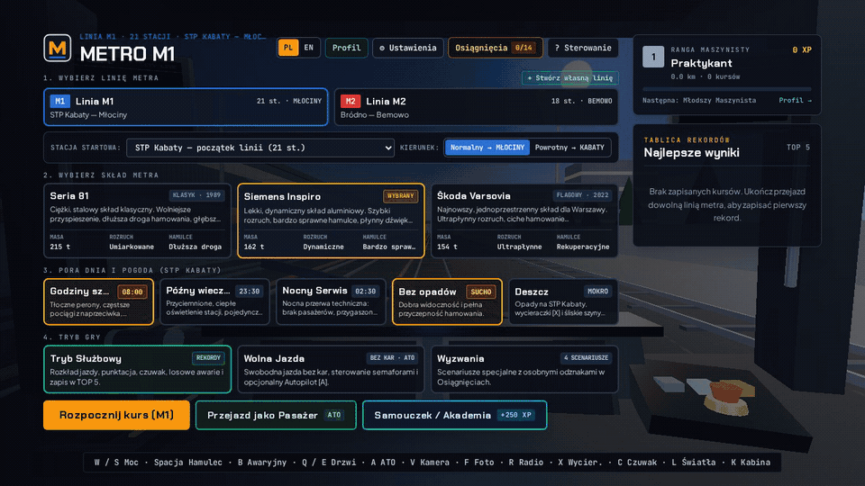
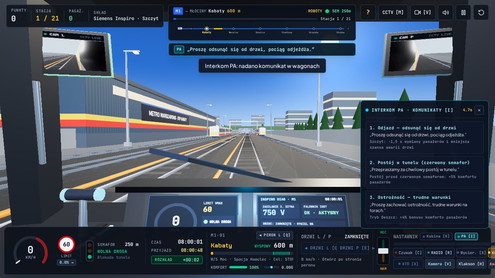
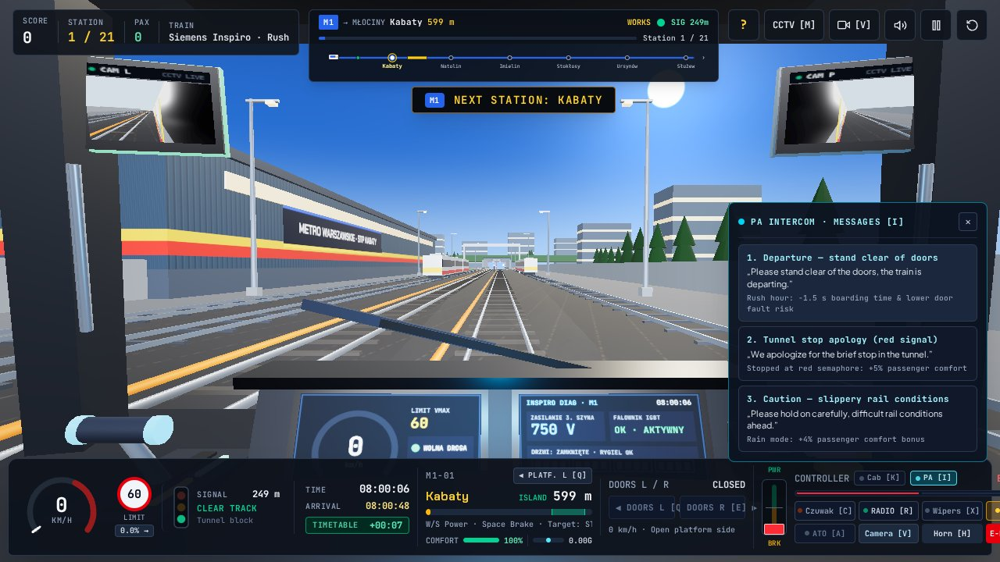
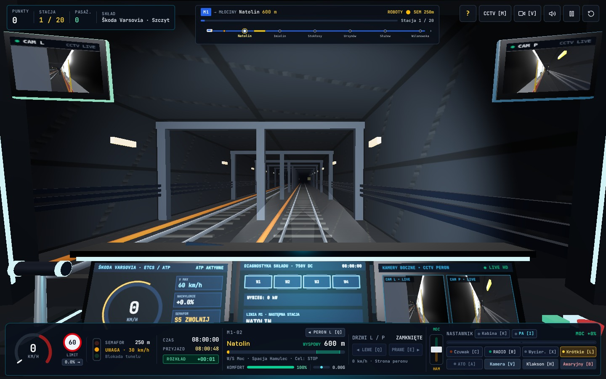
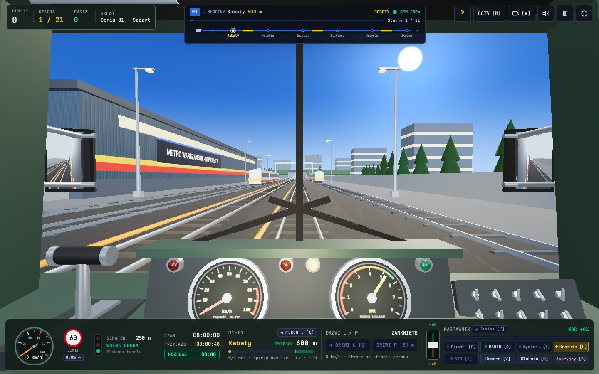
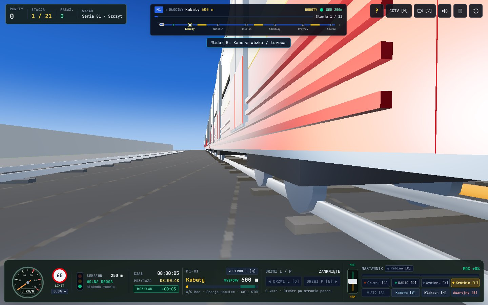
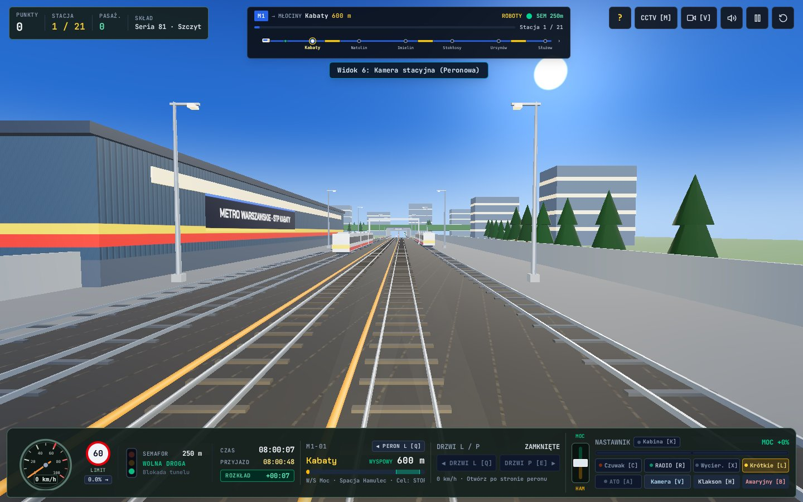

# 🚇 Metro M1 / M2 — Symulator Maszynisty 3D (Warsaw Metro Simulator)


---

## 📖 Wprowadzenie (Introduction)

**Metro M1 / M2 — Symulator Maszynisty 3D** to zaawansowany, działający w przeglądarce symulator warszawskiego metra zbudowany w oparciu o **Three.js (WebGL2)**, **React**, **TypeScript** oraz **Web Audio / Web Speech API**. Projekt kładzie nacisk na realistyczną fizykę jazdy, pełne odwzorowanie obu warszawskich linii metra (**M1 Kabaty ↔ Młociny** oraz **M2 Bemowo ↔ Bródno**), proceduralny dźwięk trakcyjny oraz architekturę **Clean Architecture / SOLID** z całkowitym oddzieleniem warstwy domenowej od silnika renderującego 3D i interfejsu użytkownika.

Gracz wciela się w maszynistę prowadzącego jeden z trzech kultowych składów warszawskiego metra w zmiennych warunkach pogodowych i porach dnia, dbając o punktualność względem rozkładu, bezpieczeństwo ruchu (semafory, ATP, czuwak, łączność radiowa) oraz komfort pasażerów.

---

## 🎬 Prezentacja wizualna (Visual Showcase)

### 🎥 Animowany podgląd rozgrywki (Live Animated Gameplay Preview — GIF z gry)



> **Prawdziwe nagranie z rozgrywki (`docs/media/gameplay-preview.gif`):**
> Animacja GIF nagrana bezpośrednio z działającego symulatora: menu główne, wymiana pasażerów na stacji, nadanie komunikatu przez **Interkom PA (`[I]`)**, zamknięcie drzwi, rozruch w tunelu z reflektorami i **Komfortem G-Force**, praca monitorów **CCTV Live** oraz przełączanie kamer (`[V]` — kabina FPP, kamera zewnętrzna, wnętrze pasażerskie, wózek napędowy przy trzeciej szynie).

---

### 🖼️ Najnowsze zrzuty ekranu z symulatora (Latest Simulator Screenshots)

#### 1. Pulpit HUD, Komfort Pasażerów (G-Force), aktywny komunikat Interkomu PA (`[I]`) oraz kamery CCTV (PL)

> **Zrzut z gry (`docs/media/latest-pa-comfort-pl.jpg`):**
> Widok z kabiny **Siemens Inspiro** podczas nadawania komunikatu przez **Interkom PA (`[I]`)**: *„Proszę odsunąć się od drzwi, pociąg odjeżdża.”* Widoczny górny baner nagłośnienia wagonowego, pasek **Komfort 100% (`0.00 G`)**, dwa monitory **CCTV LIVE (`CAM L` / `CAM P`)** oraz kompletny pulpit sterowniczy HUD.

#### 2. Angielska wersja językowa (EN) — Passenger Comfort, G-Force & Driver PA Intercom

> **Zrzut z gry (`docs/media/latest-pa-comfort-en.jpg`):**
> Pełna lokalizacja **English (`EN`)** — panel **PA Intercom · Announcements `[I]`**, wskaźnik **Comfort 100% (`0.00 G`)**, koralik linii M1 oraz ekrany diagnostyczne w kabinie.

#### 3. Kabina FPP — Škoda Varsovia z 3 ekranami dotykowymi MFD i monitorami CCTV Live

> **Zrzut z gry (`docs/media/latest-varsovia-cctv.jpg`):**
> Wnętrze kabiny najnowszego składu **Škoda Varsovia** (Kamera 1 — FPP) z trzema panoramicznymi ekranami dotykowymi (**ETCS / ATP**, **Diagnostyka Składu**, **Kamery Boczne · CCTV Peron**), podświetleniem ambientowym i górnymi monitorami **CCTV LIVE**.

#### 4. Kabina FPP — Klasyczna Seria 81 z zewnętrznymi lusterkami bocznymi 3D na wysięgnikach

> **Zrzut z gry (`docs/media/latest-seria81-mirrors.jpg`):**
> Klasyczny skład **Seria 81** z fizycznymi, trójwymiarowymi **lusterkami bocznymi 3D (`WebGLRenderTarget`)** zamontowanymi na zewnętrznych wysięgnikach po lewej i prawej stronie kabiny, analogowymi miernikami napięcia `825V` oraz klasycznym zadajnikiem jazdy.

#### 5. Wymiana pasażerów na stacji i zielona strefa zatrzymania (`STOP ZONE`)

> **Zrzut z gry (`docs/media/station-boarding.png`):**
> Postój na stacji w zielonej strefie zatrzymania (`STOP ZONE`) z otwartymi drzwiami, trwającą wymianą pasażerów oraz podglądem peronu na monitorach CCTV.

#### 6. Kamery zewnętrzne: Kamera wózka / trzeciej szyny (Kamera 5) oraz Kamera stacyjna / peronowa (Kamera 6)
| Kamera 5: Wózek napędowy i trzecia szyna (`750V DC`) | Kamera 6: Widok stacyjny / peronowy |
| :---: | :---: |
|  |  |

---

## ✨ Kluczowe funkcje (Key Features)

### 🆕 Nowe systemy operacyjne i pasażerskie
- **Komfort Pasażerów i Wskaźnik Przeciążeń (Passenger Comfort & G-Force System):**
  - Elegancki wskaźnik **Komfort (0–100%)** oraz miernik przeciążeń wzdłużnych i poprzecznych (**G-Force**) na pulpicie HUD.
  - Gwałtowne szarpanie nastawnikiem, ostre hamowanie w ostatniej chwili przed stacją, użycie hamulca awaryjnego lub zbyt szybki wjazd w łuk obniżają komfort i wywołują komunikaty ostrzegawcze (np. *„Zbyt ostre hamowanie!”*).
  - Płynne ruszanie i łagodne wyhamowywanie regenerują komfort pasażerów i przyznają bonus punktowy na podsumowaniu kursu (**do +150 pkt**).
- **Procedura Zawracania na Torze Odstawczym (Terminus Turnaround & Continuous Return Trip):**
  - Po obsłużeniu ostatniej stacji gracz może zakończyć zmianę lub wybrać **„Jedź na tor odstawczy (Kurs powrotny)”**.
  - Za stacją końcową znajduje się **250-metrowy tor odstawczy** z limitem **20 km/h**, oznakowaniem strefy zatrzymania oraz trójwymiarowym, oświetlonym na czerwono **kozłem oporowym**.
  - Po zatrzymaniu w strefie zawracania przycisk **„Zmień kabinę [T]”** przenosi maszynistę z płynnym zaciemnieniem do przeciwległej kabiny, odwraca kierunek linii na wyświetlaczach LED i koraliku trasy oraz przelicza nowy rozkład jazdy z zachowaniem ciągłości wyniku, pasażerów i XP.
- **Panel Ręcznych Komunikatów Maszynisty (Driver PA / Intercom Panel `[I]`):**
  - Kompaktowy panel z 3 komunikatami odczytywanymi syntezą mowy (**Web Speech API**) z realistycznym gongiem i pogłosem głośnika wagonowego (**Web Audio API**):
    1. *„Proszę odsunąć się od drzwi, pociąg odjeżdża.”* — skraca czas wymiany pasażerów w godzinach szczytu o **1,5 s** i zmniejsza ryzyko awarii drzwi o **65%**.
    2. *„Przepraszamy za chwilowy postój w tunelu.”* — uspokaja pasażerów podczas postoju przed czerwonym semaforem (**+5% komfortu**).
    3. *„Proszę zachować ostrożność, trudne warunki na torach.”* — daje bonus **+4% komfortu** podczas jazdy w trybie **Deszcz**.

### 🚆 Tabor, Trasy i Fizyka
- **3 szczegółowe składy 3D o unikalnej fizyce i dźwięku:**
  - **Seria 81 (Klasyk)** — ciężki skład z oporowym rozruchem, klasycznym malowaniem, zewnętrznymi lusterkami bocznymi 3D na wysięgnikach i ciepłymi reflektorami.
  - **Siemens Inspiro** — nowoczesny skład jednoprzestrzenny z falownikami IGBT, szybkim przyspieszeniem i ekranami CCTV w kabinie.
  - **Škoda Varsovia** — najnowszy pociąg warszawskiego metra z charakterystycznym pasem LED, 3 szerokimi ekranami dotykowymi, podświetleniem ambientowym i odzyskiem energii (hamowaniem elektrodynamicznym).
- **Pełne, autentyczne linie warszawskiego metra (w obu kierunkach + wybór stacji początkowej):**
  - **Linia M1 (STP Kabaty ↔ Młociny)** — odcinek naziemny STP Kabaty z wjazdem przez portal do tunelu oraz wszystkie **21 stacji** (perony wyspowe oraz boczne na stacji Centrum).
  - **Linia M2 (Bemowo ↔ Bródno)** — pełna trasa **18 stacji** z podświetlanymi kolorowymi filarami i szybszymi, nowoczesnymi rozjazdami.
  - **Kreator Własnych Linii (Custom Line Builder)** — możliwość projektowania własnych linii (np. M3, M4), konfiguracji nazw, kolorów ścian, układu peronów (wyspowy/boczny) i odległości między stacjami.
- **Realistyczny profil toru i środowisko 3D:**
  - Zakręty w poziomie z przechyłką (*cant*) i ograniczeniami prędkości na łukach, wzniesienia i spadki wpływające na bezwładność składu, rozjazdy przed stacjami, iskry z trzeciej szyny oraz dynamiczny culling segmentów tunelu gwarantujący wysokie FPS.

### 🎥 Kamery, Lusterka Live, Efekty i Tryby Gry
- **Działające w czasie rzeczywistym lusterka boczne i system CCTV (`WebGLRenderTarget` + podgląd PiP `[M]`)** oraz **6 kamer (`[V]`)**: Kabina FPP, Lusterko boczne, Kamera zewnętrzna, Wnętrze pasażerskie, Kamera wózka przy trzeciej szynie oraz Kamera peronowa.
- **Zaawansowane oświetlenie i pogoda:** światła krótkie/długie (`[L]`) z bonusem za przygaszenie przed pociągiem z naprzeciwka, lampka sufitowa w kabinie (`[K]`), tryb **Deszcz** z mokrymi szynami na odcinku naziemnym, poślizgiem kół i wycieraczkami (`[X]`).
- **6 trybów rozgrywki:**
  - **Służba (Duty)** — jazda rozkładowa na punkty, oceny `S–D`, rekordy, Ghost Delta na żywo i wykres **Tachografu** na podsumowaniu.
  - **Akademia Maszynisty (Tutorial)** — interaktywne szkolenie krok po kroku z podświetlaniem kontrolek i przyznaniem Licencji Maszynisty.
  - **Wyzwania (Challenges)** — scenariusze specjalne (*Awaria falownika*, *Czarna seria*, *Przejazd techniczny*).
  - **Nocny Serwis / Inspekcja Tunelu (02:30)** — przejazd inspekcyjny przez przygaszone stacje z oświetlonymi ekipami spawaczy w tunelu (wymóg zwolnienia do `≤ 20 km/h` i podania sygnału `Klakson [H]`).
  - **Przejazd jako Pasażer (ATO)** oraz **Tryb Swobodny (Sandbox)** z obsługą **Autopilota ATO (`[A]`)**.
- **Tryb Fotograficzny (`[F]`)** z wolną kamerą 3D, regulacją FOV, przechyłu (Tilt), filtrami kolorystycznymi i zapisem zrzutów do pliku PNG.
- **Pełna obsługa kontrolerów (Gamepad API z wibracjami), ekranów dotykowych (Mobile / Tablet)** oraz **dwujęzyczny interfejs (Polski / Angielski)**.

---

## ⌨️ Sterowanie (Controls Overview)

| Klawisz / Kontrolka | Funkcja |
| :--- | :--- |
| `W` / `S` lub `↑` / `↓` | Zwiększ / zmniejsz moc i hamowanie (nastawnik jazdy) |
| `Spacja` | Hamulec roboczy (płynne zwalnianie) |
| `B` | Hamulec awaryjny |
| `Q` / `E` | Otwórz / zamknij drzwi **Lewe** (peron wyspowy) / **Prawe** (peron boczny) |
| `I` | **Interkom PA** — panel ręcznych komunikatów głosowych dla pasażerów |
| `T` | **Zmień kabinę** na torze odstawczym (rozpocznij ciągły kurs powrotny) |
| `L` / `K` | Przełącz reflektory (Wył. → Krótkie → Długie) / Lampka w kabinie |
| `C` / `R` | Potwierdzenie **Czuwaka** / Potwierdzenie **Radia dyspozytora (+40 pkt)** |
| `H` / `X` | Klakson / Wycieraczki przedniej szyby |
| `V` / `M` | Zmiana kamery (1–6) / Powiększony monitor **CCTV PiP** |
| `A` | Autopilot **ATO** (w trybie Sandbox i Przejazd Pasażera) |
| `F` | **Tryb Fotograficzny** (wolna kamera na pauzie + eksport PNG) |
| `P` / `Esc` / `?` | Pauza i Ustawienia / Pomoc ze skrótami klawiszowymi |

---

## 🚀 Instalacja i uruchomienie po sklonowaniu w IDE (Installation & Setup)

Projekt korzysta z bundlera **Vite 8** oraz menedżera pakietów **npm** (w repozytorium znajduje się również `bun.lock` dla **Bun**).

### Wymagania wstępne
- **Node.js** w wersji `>= 20.19.0` lub `>= 22.12.0` (wymagane przez silnik **Vite 8**)
- Przeglądarka wspierająca **WebGL2**, **Web Audio API** oraz **Web Speech API** (Chrome, Edge, Firefox, Safari)

### Kroki instalacji po `git clone` w lokalnym IDE (VS Code / WebStorm / Cursor)

1. **Sklonuj repozytorium i otwórz katalog projektu w IDE:**
   ```bash
   git clone https://github.com/TWOJ-LOGIN/metro-m1.git
   cd metro-m1
   ```

2. **Zainstaluj zależności (wybierz wariant odpowiedni dla swojego środowiska):**

   - **Wariant A — Zalecany przy szybkim uruchomieniu w IDE (`--omit=dev`):**
     Wszystkie pakiety niezbędne do uruchomienia serwera deweloperskiego i bundlera (`vite`, `@vitejs/plugin-react`, `@tailwindcss/vite`, `three`, `react`) znajdują się w głównych `dependencies`. Użycie flagi `--omit=dev` pomija instalację opcjonalnych narzędzi z `devDependencies` i zapobiega konfliktom `ERESOLVE` w starszych środowiskach npm:
     ```bash
     npm install --omit=dev
     ```

   - **Wariant B — Pełna instalacja z narzędziami deweloperskimi (`typescript`, `tsx`, `@types/*`):**
     Jeśli chcesz uruchamiać w IDE lokalny kompilator `tsc --noEmit` oraz testy jednostkowe `tsx`:
     ```bash
     npm install
     ```
     *(W przypadku wystąpienia konfliktu wersji peer-dependencies w Twojej wersji npm użyj: `npm install --legacy-peer-deps`)*

   - **Wariant C — Instalacja za pomocą Bun (z użyciem `bun.lock`):**
     ```bash
     bun install
     ```

3. **Uruchom serwer deweloperski Vite (domyślnie na porcie `3000`):**
   ```bash
   npm run dev
   ```
   Następnie otwórz w przeglądarce adres: `http://localhost:3000`

4. **Zbuduj wersję produkcyjną i uruchom podgląd:**
   ```bash
   npm run build
   npm run preview
   ```

5. **Sprawdzanie typów TypeScript oraz testy jednostkowe warstwy domenowej** *(wymaga pełnej instalacji z Wariantu B lub C)*:
   ```bash
   npm run lint
   npx tsx --test src/domain/*.test.ts
   ```

---

## 🏗️ Architektura projektu (Clean Architecture & SOLID)

Kod źródłowy przestrzega rygorystycznego rozdzielenia odpowiedzialności (**Separation of Concerns**):

- `src/domain/` — czysta logika domenowa i symulacyjna TypeScript (zero zależności od DOM, Reacta czy Three.js): fizyka pociągu, profil toru, semafory, rozkład, komfort pasażerów i G-Force (`comfortSystem.ts`), procedura zawracania (`turnaroundSystem.ts`), interkom PA (`paIntercomSystem.ts`), autopilot ATO, awarie, pogoda, profil maszynisty i osiągnięcia + komplet testów jednostkowych (`*.test.ts`).
- `src/scene/` — silnik renderowania 3D w **Three.js**: budowniczy tunelu, stacji, składów 3D, kokpitów FPP, systemu lusterek i kamer CCTV (`WebGLRenderTarget`), kozła oporowego na torze odstawczym (`turnaroundSidingBuilder.ts`) oraz efektów cząsteczkowych.
- `src/audio/` — proceduralny silnik dźwiękowy **Web Audio API** (dźwięk falowników, stukot szyn, syk pneumatyki, trzaski trzeciej szyny, gong i echo interkomu PA) oraz syntezator zapowiedzi **Web Speech API**.
- `src/input/` — kontrolery wejścia dla klawiatury oraz padów (**Gamepad API**).
- `src/components/` & `src/hooks/` — responsywny interfejs użytkownika w **React + Tailwind CSS** z pełną lokalizacją PL/EN.
